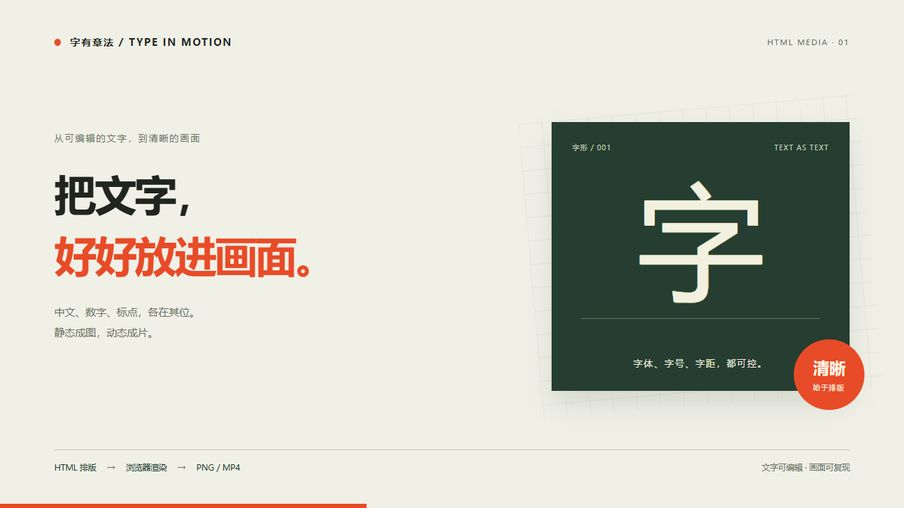

# HTML Media

**文字可编辑，浏览器负责排版，画面按时间渲染。**

[English](README.md) · [参与贡献](CONTRIBUTING.md) · [发展路线](docs/ROADMAP.md) · [使用示例](docs/EXAMPLES.md)

[](https://github.com/hanqin62-sketch/html-media.skill/actions/workflows/ci.yml)
[](LICENSE)

一个把 HTML/CSS/SVG 渲染成 PNG、JPEG 和 MP4 的开源 AI 技能。让 AI 负责构图，让浏览器使用真实字体排字，同时保留 HTML，方便下一次修改。

适合中文海报、封面、图卡、界面截图和动态排版。项目由 [hanqin62-sketch](https://github.com/hanqin62-sketch) 发起，与 Codex 协作建立。欢迎大家一起贡献作品、修复问题、改进流程，让它在真实使用中逐步成长。



[查看或下载 4 秒视频示例](docs/media/motion.mp4) · [可编辑 HTML 源码](skills/html-media/assets/scene.html)

## 它怎么工作

```text
需求 + 准确文案 + 素材
          ↓
可编辑的 HTML/CSS/SVG
          ↓
浏览器排版、加载字体并渲染
          ↓
PNG / JPEG，或逐帧采样 → FFmpeg → MP4
```

- 文字保留为真实文本节点，可控制字体、字号、字距与换行。
- 导出 PNG/JPEG，支持倍图和透明 PNG 图层。
- 通过确定性的 `renderAt(seconds)` 时间函数生成视频帧。
- 等待字体和素材就绪，素材缺失时报错，默认保护已有输出。
- 输出 JSON 报告，记录尺寸、时间、DOM 文本和基础溢出提示。
- 提供可编辑源码、中英文说明和可复用的本地渲染脚本。

**当前边界：**辅助脚本输出无声 H.264 MP4。目前没有自动去除旧字、字体匹配、运动跟踪、内嵌媒体自动同步、OCR 或自动视觉修复。使用真实字体不代表文案一定正确、字体一定不缺字，成品仍需检查。未实现的方向单独列在[路线图](docs/ROADMAP.md)中。

## 快速开始

需要 **Node.js 22+**、npm 和 Chromium 系浏览器。视频导出与完整测试需要 **支持 libx264 的 FFmpeg，以及 ffprobe**。中文示例需要 Noto Sans CJK SC、微软雅黑或苹方等中文字体；仓库不附带字体文件和 FFmpeg。

```sh
git clone https://github.com/hanqin62-sketch/html-media.skill.git
cd html-media.skill
npm ci
npx playwright install chromium
npm run demo:image
```

图片输出到 `outputs/poster.png`。装好 FFmpeg 后运行：

```sh
npm run demo:video
```

视频输出到 `outputs/motion.mp4`，规格为 1280×720、4 秒、24 帧/秒、无声。示例命令只覆盖各自同名的示例输出。Linux 可用 `npx playwright install --with-deps chromium` 安装浏览器及系统依赖，可能需要管理员权限。更多参数与排错见[使用指南](docs/USAGE.zh-CN.md)。

## 安装为 Skill

克隆仓库后执行：

```sh
npm run install:skill
```

跨平台安装脚本会把独立技能复制到 `~/.agents/skills/html-media`，并显示依赖安装命令。它不会自动下载安装依赖，也不会覆盖已有技能。指定其他位置：

```sh
npm run install:skill -- --dest /absolute/path/to/skills/html-media
```

进入安装后的技能目录运行 `npm ci`；若没有可用浏览器，再运行 `npx playwright install chromium`。宿主自带 Playwright 时也可复用现有运行环境。还可以让 Codex 的 skill installer 从本仓库安装 `skills/html-media`。不同宿主的发现路径可能不同，参考 [Codex 官方说明](https://learn.chatgpt.com/docs/build-skills)，避免在多个扫描路径重复安装同名技能。

安装后可以这样说：

> 用 $html-media 制作一张 1280×720 的中文活动海报，标题逐字保留，导出 PNG，检查成品，并返回可编辑 HTML。

> 用 $html-media 制作一个 4 秒、24 帧/秒的动态标题，导出无声 MP4，检查开头、中间和结尾的画面。

也可以不用 AI，直接运行渲染器：

```sh
npm run render -- --html scene.html --out outputs/card.png --width 1080 --height 1080
```

## 开发与验证

```sh
npm ci
npx playwright install chromium
npm run validate
npm test
```

完整测试需要 FFmpeg/ffprobe，会验证真实浏览器输出：PNG 尺寸和透明通道、相同时间画面的一致性、JPEG、视频元数据、素材缺失报错、已有文件保护。CI 配置覆盖 Linux 和 Windows。字体、浏览器与系统会影响字形渲染，示例图不是跨平台逐像素一致性的承诺。

```text
skills/html-media/     可安装技能、渲染器、参考文档和模板
scripts/              仓库验证器、安装脚本
tests/                测试素材与行为测试
docs/                 使用指南、示例、路线图和成品预览
.github/              自动检查、Issue 表单、PR 模板
```

## 一起参与

阅读[贡献指南](CONTRIBUTING.md)。中文、英文 Issue 和 PR 都欢迎。一个可复现的小例子非常有帮助：提供预期文字、HTML、实际图片，以及具体哪里不对。[Issue 模板](https://github.com/hanqin62-sketch/html-media.skill/issues/new/choose)会引导填写这些信息。

请说明实际完成的测试，去掉样例中的隐私数据，并区分想法与已经实现的功能。参与交流请遵守[行为准则](CODE_OF_CONDUCT.md)，安全问题参考[安全说明](SECURITY.md)。

## 许可与致谢

[MIT 许可证](LICENSE)，© 2026 hanqin62-sketch 和贡献者。依赖以及用户提供的字体、图片和音频遵循各自许可。仓库不包含专有字体文件。

本项目把已有的“代码排版与浏览器渲染”方法整理成可在本地执行的 AI 工作流。底层使用 [Playwright](https://playwright.dev/) 和 [FFmpeg](https://ffmpeg.org/)，相关项目包括 [HTML/CSS to Image](https://htmlcsstoimage.com/) 与 [Remotion](https://www.remotion.dev/)。这是独立社区项目，不是 OpenAI、Playwright 或 Remotion 官方产品。
