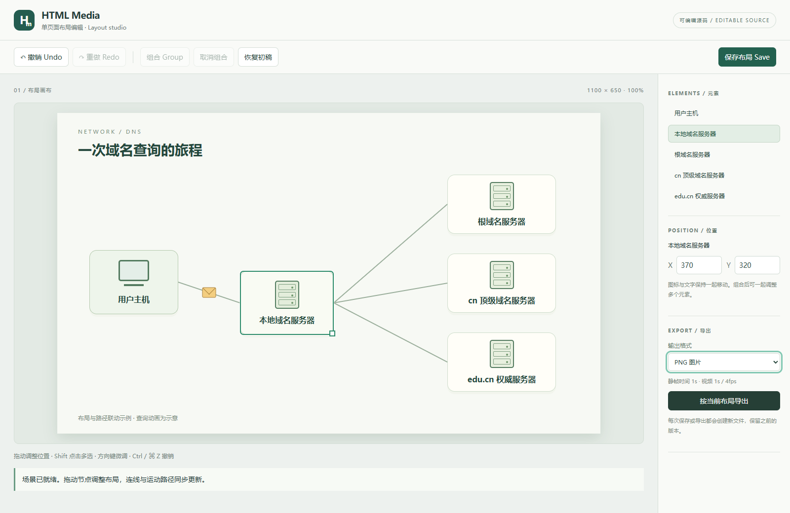
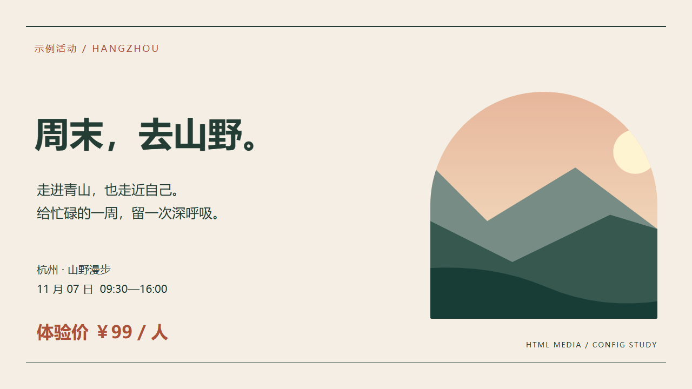
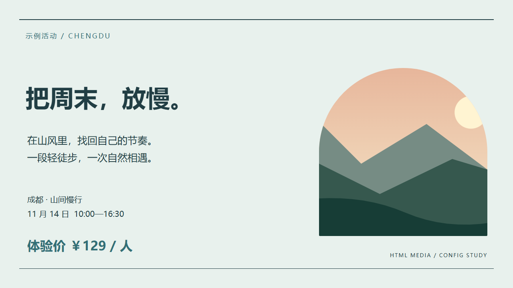

# Examples / 使用示例

[English home](../README.md) · [中文首页](../README.zh-CN.md)

## Interactive layout / 交互布局

Run `npm run demo:editor`, then open the printed loopback URL. The original MIT-licensed [DNS template](../skills/html-media/assets/templates/network.html) and [layout config](../skills/html-media/assets/examples/network.json) demonstrate grouped icon/label movement, linked lines and deterministic message motion. Save a new config revision or export directly. This is an illustrative animation, not a complete DNS protocol simulation. See the [editor guide](../skills/html-media/references/editor.md) / [中文指南](../skills/html-media/references/editor.zh-CN.md).

运行命令后打开终端中的本地地址，拖动主机，连线及消息路径随之更新。可以组合、撤销、保存新配置并导出。示例为原创 MIT 许可作品，仅用于展示布局联动，不是完整的 DNS 协议模拟。



## Included demo / 内置示例

[Editable scene](../skills/html-media/assets/scene.html) · [PNG](media/poster.png) · [4-second silent MP4](media/motion.mp4)

The demo is original HTML/CSS artwork created for this project. No external images or font files are included. It uses system font fallbacks; render results vary across machines. The bundled previews were rendered on Windows with a local CJK font.

示例为本项目制作的原创 HTML/CSS 画面，不含外部图片或字体文件。它使用系统字体回退，不同机器的字形可能不同。附带预览在 Windows 上使用本地中文字体渲染。

```sh
npm run demo:image
npm run demo:video
```

## Checked gallery / 带检查的案例库

Run `npm run demo:checked` after installing the dependencies. It exports three 1280×720 PNGs and a 4-second, 24 fps silent motion-title MP4 into `outputs/`. Every export uses an independent copy manifest and strict checks; CI runs the same command. Set `HTML_MEDIA_TEST_BROWSER` to a browser executable only if automatic discovery is unavailable.

安装依赖后运行 `npm run demo:checked`，在 `outputs/` 输出三张 1280×720 PNG 和一个 4 秒、24 帧/秒的无声动态标题 MP4。每个成品均使用独立原文清单及严格检查；CI 也执行此命令。自动找不到浏览器时可设置 `HTML_MEDIA_TEST_BROWSER` 为浏览器路径。

| Case / 案例 | Editable source / 源码 | Copy / 原文清单 | Purpose / 用途 |
| --- | --- | --- | --- |
| Poster / 海报 | [scene.html](../skills/html-media/assets/scene.html) | [poster.copy.json](../skills/html-media/assets/examples/poster.copy.json) | Chinese text and explicit line breaks / 中文与显式换行 |
| Image overlay / 图上叠字 | [overlay.html](../skills/html-media/assets/examples/overlay.html) | [overlay.copy.json](../skills/html-media/assets/examples/overlay.copy.json) | Native-size background and separate text / 原尺寸底图与独立文字 |
| Motion title / 动态标题 | [motion.html](../skills/html-media/assets/examples/motion.html) | [motion.copy.json](../skills/html-media/assets/examples/motion.copy.json) | Deterministic fade/slide and visibility windows / 确定性淡入移动与可见时间区间 |


The overlay background is an original [SVG landscape](../skills/html-media/assets/examples/landscape.svg), not a photograph. All gallery HTML/CSS/SVG sources are project-authored and MIT licensed. Fonts use system fallbacks and are not redistributed. For a real photo, replace the background with a user-authorized asset and match its native dimensions; this case does not remove old lettering or restore backgrounds automatically.

叠字底图是项目原创的 SVG 风景插画，不是照片。所有案例 HTML/CSS/SVG 源码使用 MIT 许可；字体使用系统回退，不附带字体文件。实际照片请换成用户授权的素材并匹配原尺寸；该案例不自动去旧字或修复背景。

To export only the transparent text layer, make a copy of `overlay.html`, hide `#source`, keep the CSS background transparent, and render with `--transparent`; retain the manifest. See [inspection rules](../skills/html-media/references/inspection.md) / [中文核对规则](../skills/html-media/references/inspection.zh-CN.md).

导出透明文字层时，复制 `overlay.html`，隐藏 `#source`、保持 CSS 背景透明，再用 `--transparent` 渲染，继续保留原文清单。

## Reproducible failures / 可复现的失败案例

[Inspection fixture](../tests/fixtures/inspection.html) and [behavioral tests](../tests/render.test.cjs) demonstrate full-width punctuation mistakes, repeated-space changes, hidden nested spans, ancestor clipping, nonunique selectors, and a video layer that exits the viewport only at 0.25 seconds. Run `npm test`; these deliberately broken scenes must produce the expected findings, so a passing test does not mean the fixture itself is valid artwork.

检查夹具及行为测试覆盖全角标点错误、连续空格变化、嵌套文字隐藏、祖先容器裁切、非唯一选择器，以及仅在第 0.25 秒越界的视频文字。运行 `npm test`；测试要求这些故意有问题的画面被正确发现，测试通过不表示失败案例本身是合格成品。

## Configured template / 配置复用模板

The [event template](../skills/html-media/assets/templates/event.html) is shared by the [Hangzhou config](../skills/html-media/assets/examples/event-hangzhou.json) and [Chengdu config](../skills/html-media/assets/examples/event-chengdu.json). Change the JSON to replace copy, theme colors, title size, or the local image. Configured text automatically drives exact-copy/layout inspection. These are fictional examples with original MIT-licensed artwork and system font fallbacks.

同一个活动模板搭配杭州、成都两份配置；修改 JSON 即可替换文案、主题色、标题字号及本地图片，原文自动接入核对与排版检查。活动内容为演示，底图为原创 MIT 许可素材，字体使用系统回退。

```sh
npm run demo:config
```





See the [configuration guide](../skills/html-media/references/configuration.md) / [中文配置指南](../skills/html-media/references/configuration.zh-CN.md) for the schema, relative paths, and template requirements. To reproduce one export from the repository:

```sh
node skills/html-media/scripts/render.cjs --config skills/html-media/assets/examples/event-hangzhou.json --out outputs/event.png --width 1280 --height 720 --strict-checks
```

## Prompt: exact-copy poster / 提示词：准确文案海报

> Use $html-media to create a 1080×1440 poster. The title must be exactly “把文字，好好放进画面。” Use a warm paper background, dark green typography, and one orange accent. Return a PNG and editable HTML. Inspect the actual render for missing glyphs, clipping, and copy errors.

> 用 $html-media 制作一张 1080×1440 海报。标题必须逐字为“把文字，好好放进画面。”，暖纸色背景、深绿色文字、一处橙色点缀。交付 PNG 和可编辑 HTML，检查实际图片里的缺字、裁切和文案。

## Prompt: overlay on an image / 提示词：原图叠字

> Use $html-media to add the supplied caption to this image at its native dimensions. Keep the existing composition and put the caption in the empty lower-left area. Return the composite PNG, a transparent text overlay, and the HTML with relative assets. Inspect legibility and overlap.

> 用 $html-media 在这张原图上加指定文字，保持原图尺寸和构图，放在左下方空白处。交付合成 PNG、透明文字图层，以及引用相对素材路径的 HTML，检查可读性和遮挡。

This is an instructed compositing workflow, not automatic old-text removal or automatic region-difference verification. 这是引导式合成流程，不表示已经具备自动去旧字或区域差异自动检查。

## Prompt: motion title / 提示词：动态标题

> Use $html-media to turn this poster into a 4-second, 24 fps motion title. Fade and slide the text in during the first second, hold the finished composition at the end, and keep the copy unchanged. Use deterministic renderAt(seconds), export a silent MP4, and inspect representative encoded frames.

> 用 $html-media 把海报做成 4 秒、24 帧/秒的动态标题。第一秒让文字淡入并小幅移动，结束前停留在完整画面，文案不变。使用确定性的 renderAt(seconds)，导出无声 MP4，并检查编码后的视频代表帧。

## Batch report and font observation / 批量报告与字体观察

Run `npm run demo:batch` to render both city configs into a new directory, with an offline `index.html` containing media previews, actual font families, readable findings, and expandable JSON details. The location is saved in `outputs/latest-batch.txt`. Copy/layout inspection is strict; font observation is enabled. No external fonts are redistributed in these examples.

运行 `npm run demo:batch`，两份城市配置会输出到新目录，离线 `index.html` 展示成品预览、实际字体、问题摘要和可展开的 JSON 明细；目录位置保存到 `outputs/latest-batch.txt`。默认严格检查原文和排版，并观察字体。案例不附带外部字体文件。

See [batch usage](../skills/html-media/references/batch.md) / [批量说明](../skills/html-media/references/batch.zh-CN.md), and [font checks](../skills/html-media/references/fonts.md) / [字体检查](../skills/html-media/references/fonts.zh-CN.md).

The original synthetic [test font](../tests/fixtures/test-font.ttf) contains only `A` and space. Its [generator](../tests/fixtures/build_test_font.py) and tests intentionally exercise missing characters and fallback; this MIT-licensed fixture is not a general-purpose font.

## Share an example / 分享案例

Open a [showcase issue](https://github.com/hanqin62-sketch/html-media.skill/issues/new/choose). Include editable source, a small preview, reproduction commands, and asset/font licensing notes. Remove private data and local paths first.

可通过作品展示 Issue 提交可编辑源码、小尺寸预览、复现命令和素材/字体许可说明，提交前去除隐私与本机路径。
